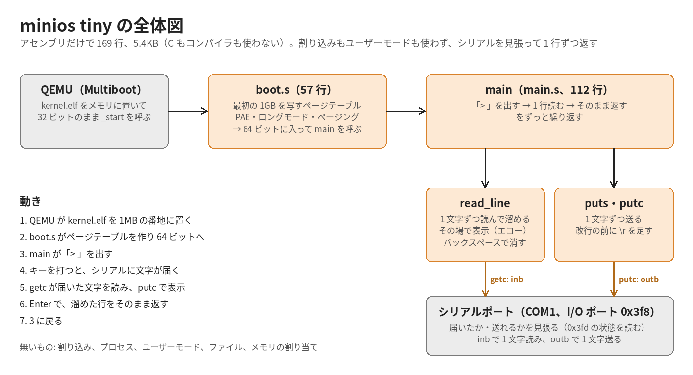
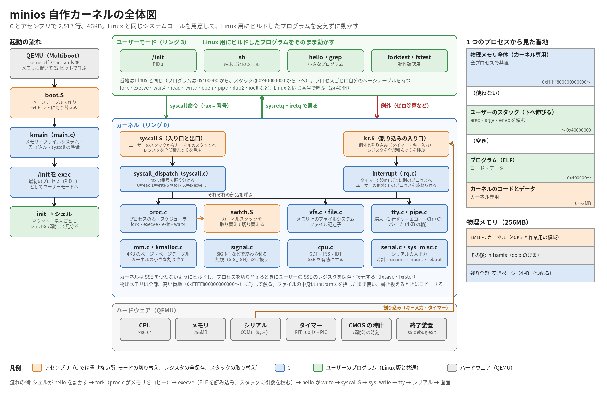

# minios

Linux カーネルの上に、自分で書いた init とシェルだけを載せた小さな OS。
AI が 1 周ずつ育てた記録は [JOURNAL.md](JOURNAL.md) にある。

- カーネル: Linux 7.2.8 を tinyconfig から必要なものだけ足して作る（テスト用 1.5MB）
- init（PID 1）とシェル: C、libc なし、システムコール直叩き（コード 16KB）
- 外部プログラム: C（progs/）と Go（goprogs/gobox、busybox 方式の 1 本）
- UEFI 版: OS 全体が 1 ファイル（BOOTX64.EFI、4.3MB）。USB メモリに置けば実機で起動するはず（未確認）

## いちばん小さい自作カーネル（tiny/）

`./run.sh tiny` で起動する。アセンブリだけ（169 行、5.4KB）で、1 行読んでそのまま返すだけ。ビルドに使うのはアセンブラとリンカ（binutils）だけ。ここから自分たちの設計で育てる。



## 自作カーネル（kernel/、Linux 互換）の全体図



（`python3 docs/architecture.py` で描き直せる）

## 動かす

```sh
./run.sh tiny       # いちばん小さい自作カーネル（tiny/、echo だけ）で起動する
./run.sh scratch    # Linux の代わりに自作カーネル（kernel/）で起動する
MINIOS_KERNEL=scratch ./test.py   # 同じテストを自作カーネルに向けて回す
./run.sh            # QEMU で起動（シリアル）。Ctrl+C はゲストに届く。QEMU を強制終了するには Ctrl+A → X
./run-efi.sh        # UEFI 版を実機と同じ経路（UEFI → FAT 上の BOOTX64.EFI）で起動
./run-efi.sh gui    # 画面のウィンドウも開き、USB キーボードで操作する（WSL なら WSLg）
./test.py           # 自動テスト（32 個）。ローカル LLM のテストは ./fetch-third-party.sh と ./build-models.sh の後
MINIOS_SLOW=1 ./test.py grow_7b        # 7B のモデルで作って育てる（数分）。UEFI 版のテストは ./build-efi.sh の後だけ動く
MINIOS_INTERNET=1 ./test.py internet   # インターネットに出るテスト（DNS、HTTPS）
```

起動したら `help` でコマンドの一覧が出る。

```
minios# help
minios# ps
minios# ping 10.0.2.2
minios# fetch https://example.com/
minios# echo hello > /data/note      # /data は再起動しても残る
minios# grow sum print the sum of the integer arguments   # OS の中の AI がプログラムを書いて入れる
minios# grow sum print the result followed by a newline  # もうあれば育てる（-log で履歴、-undo で戻す）
minios# grow -model 1.5b ...                               # 速い小さなモデルで（既定は一番大きい 7B）
minios# shutdown
```

## ファイル

| ファイル | 中身 |
|---|---|
| init.c | PID 1。起動処理を呼び、端末ごとにシェルを起動して見守る。孤児を回収する |
| boot.h | 起動処理: マウント、起動メディアの検出、DHCP でネットワーク、終了時のアンマウント |
| shell.h | シェル: 組み込みコマンド、リダイレクト、外部プログラムの実行、Ctrl+C |
| lib.h・net.h・crt.h・sha256.h・seccomp.h | libc の代わり（システムコール、文字列、ソケット、DHCP、スタートアップ、SHA-256、seccomp） |
| progs/ | C の外部プログラム（hello、spin、orphan、screen など） |
| goprogs/gobox/ | Go の外部プログラム（fetch、gohello）。1 本にまとめてある |
| kernel.fragment | tinyconfig に足す（`!` は削る）カーネルオプション。1 行ずつ理由つき |
| kernel-efi.fragment | UEFI 版で足すもの（ACPI、EFI、画面、キーボード、USB メモリ、FAT、実機の NIC） |
| initramfs.list | initramfs の中身 |
| build.sh・build-efi.sh | ビルド（テスト用、UEFI 版） |
| kbuild-env.sh | カーネルに埋め込まれるビルドした人・マシン・日時を固定する（個人の情報を残さない） |
| NOTICE.md | 同梱している部品とライセンス。本文は OS の中の /licenses にもある |
| fetch-third-party.sh | サードパーティ（TinyCC など）を決まった版で third_party/ に取ってくる（最初に 1 回） |
| build-models.sh | モデル用のディスク build/models.img（ext4、/models）を作る |
| fragment-args.awk | kernel.fragment を scripts/config の引数にする（NAME、!NAME、NAME=VALUE） |
| examples/ | OS の中でコンパイルするお手本（/usr/share/minios/examples） |
| tools/fuzz_dhcp.c | DHCP の応答の解析を AddressSanitizer つきでファジングする（test.py から実行） |
| test.py | QEMU をシリアル越しに操作する自動テスト |
| JOURNAL.md | 周ごとの記録（やったこと、サイズ、分かったこと） |

カーネルのソースは linux-7.2.8/（git 管理外）、ビルド結果は build/（git 管理外）。
disk.img は run.sh が使う永続ディスク（初回に作る。消せば空に戻る）。

## 育て方（3 層）

| 層 | 変え方 | 例 |
|---|---|---|
| カーネル + init | ソースを変えてビルドし直す | kernel.fragment、init.c・boot.h・shell.h |
| /data/bin | grow で AI に作らせる。または置いて trust する（記録の無いもの・書き換えられたものは実行されない） | `grow sum ...`、`fetch -o /data/bin/x <URL>; chmod 755 /data/bin/x; trust x` |
| /data/rc | 書くだけ（起動時に実行される） | `echo echo hello > /data/rc` |

## 実機の USB メモリで試す（未確認）

QEMU の UEFI（OVMF）では、USB メモリからの起動、画面、USB キーボード、Intel e1000e での DHCP まで確かめた。実機ではまだ試していない。

1. `./build-efi.sh` で build/efi/EFI/BOOT/BOOTX64.EFI を作る
2. USB メモリを FAT32 で初期化し、`EFI/BOOT/BOOTX64.EFI` の形でコピーする
3. PC の UEFI 設定で **セキュアブートを切る**（BOOTX64.EFI は署名していない）
4. USB メモリから起動する

データは USB メモリの `minios-data/` に保存される。

実機で足りない可能性が高いもの:

- NIC: 入れたのは Intel（e1000・e1000e）と Realtek（r8169）の有線だけ。Wi-Fi は無い。r8169 はチップによってファームウェアが要る
- 内蔵ディスク（NVMe・SATA）のドライバは無い（使わないので）
- 画面は UEFI が用意した画面（GOP）をそのまま使う。解像度は変えられない
- ノート PC のキーボードは PS/2 として見えることが多い（入れてある）が、機種によっては別のドライバが要る
